# Lumo & Nox – Activiteitendiagrammen (PlantUML)

Elk blok hieronder is een compleet diagram. Kopieer het van `@startuml` tot en met `@enduml` en plak het op plantuml.com om het te renderen.

## 00 – Een level spelen (overzicht)

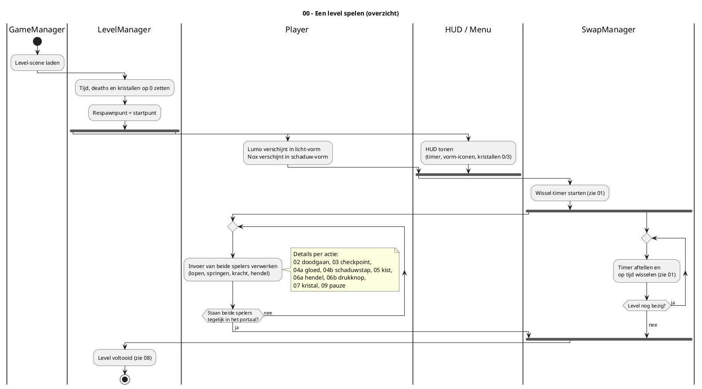

## 01 – Wissel van vorm

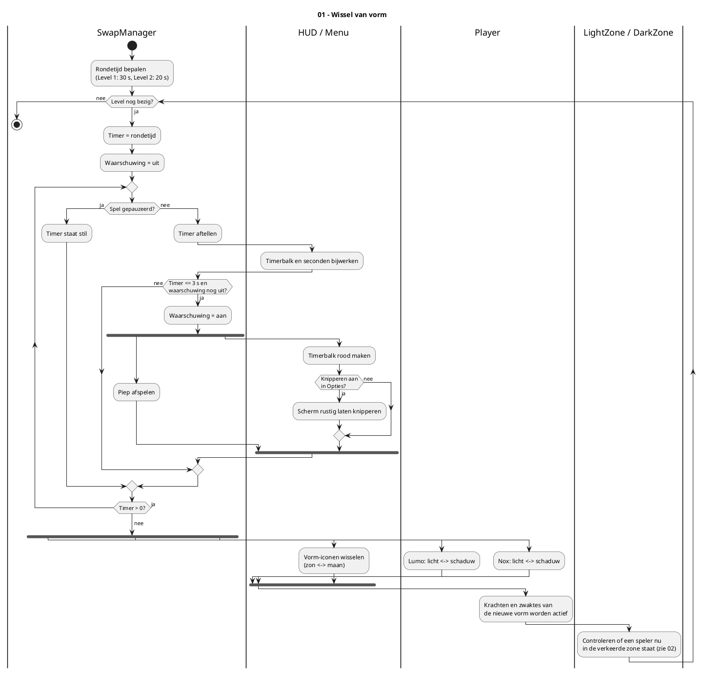

## 02 – Doodgaan en respawnen

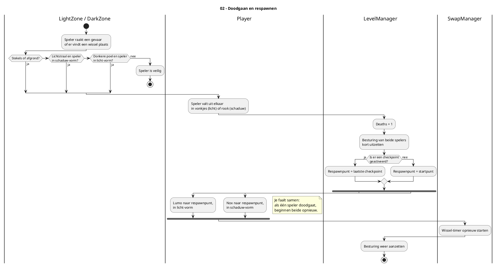

## 03 – Checkpoint activeren

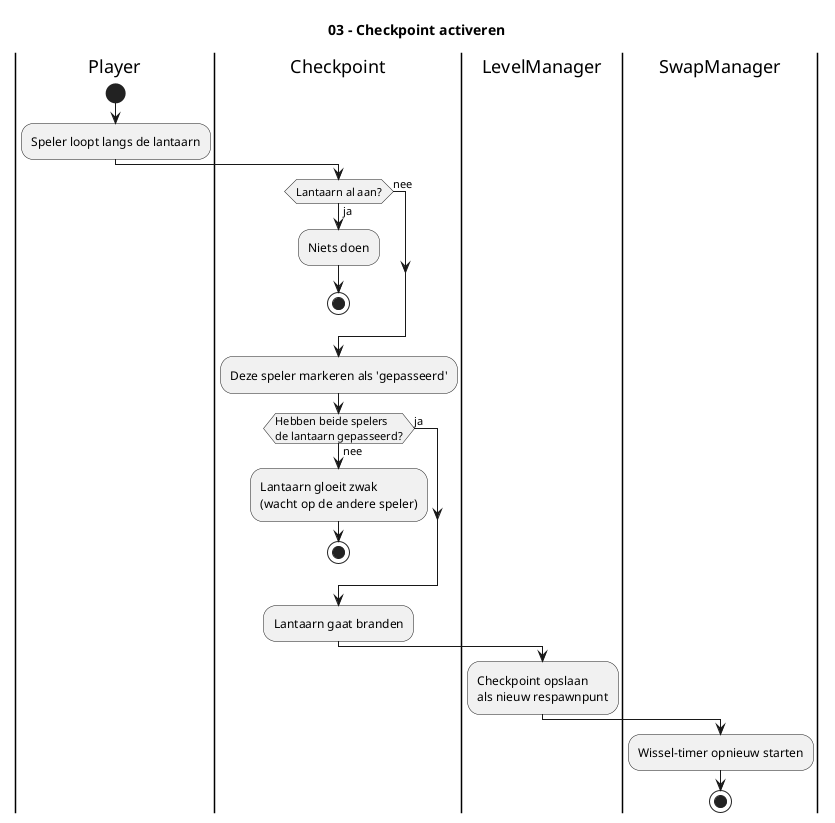

## 04a – Kracht in licht-vorm: Gloed

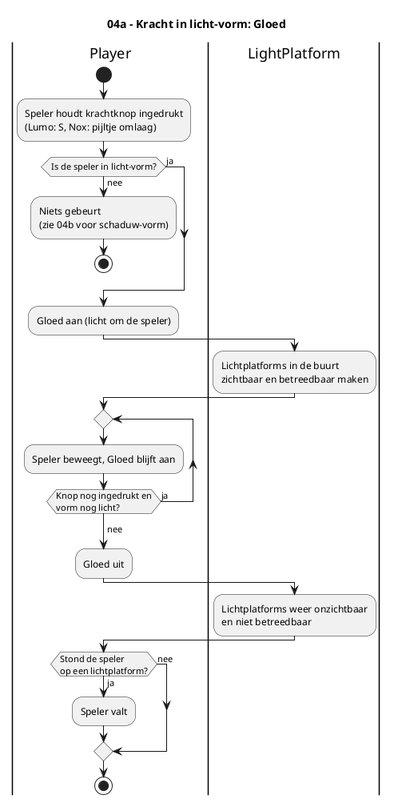

## 04b – Kracht in schaduw-vorm: Schaduwstap

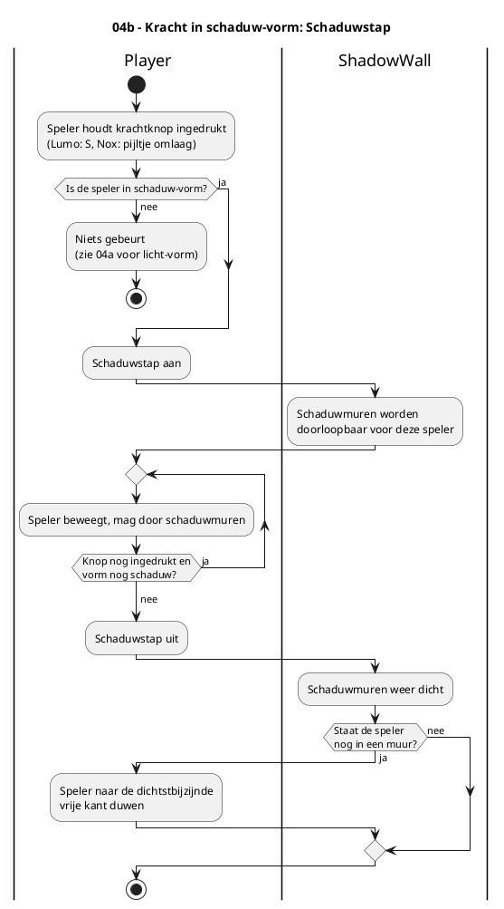

## 05 – Kist duwen (alleen Nox)

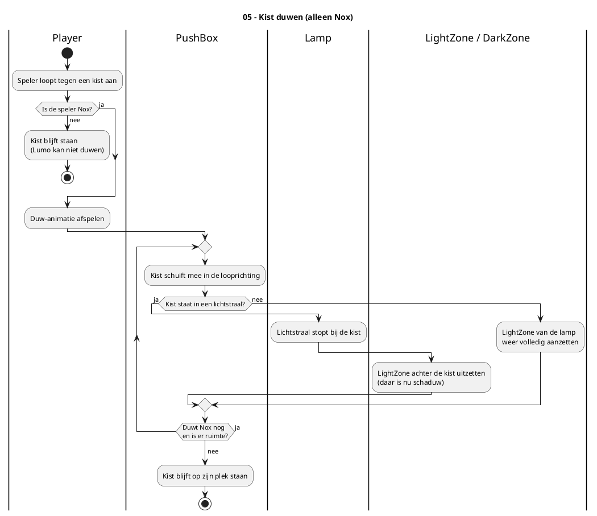

## 06a – Hendel gebruiken

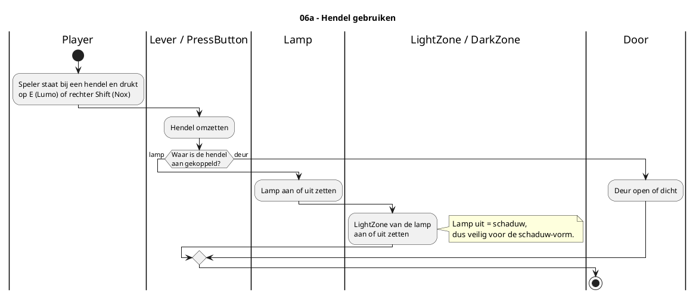

## 06b – Drukknop en deur

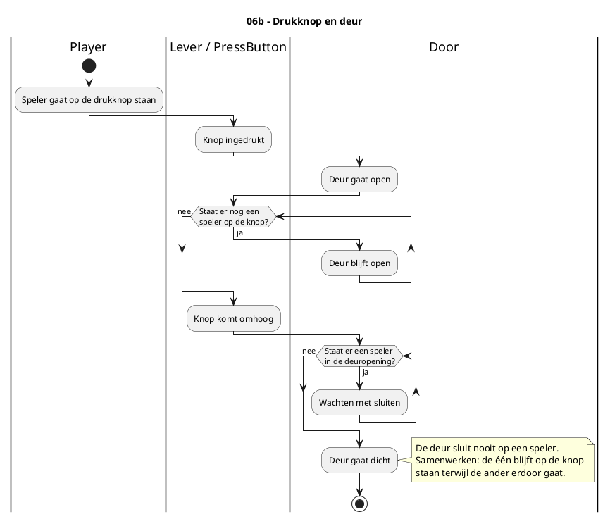

## 07 – Kristal oppakken

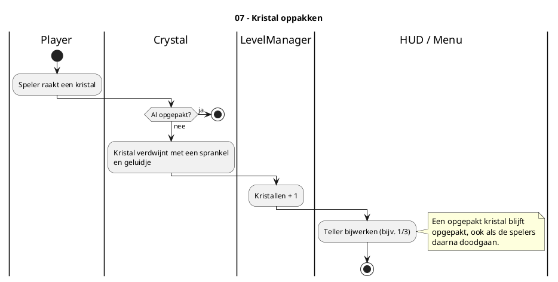

## 08 – Level voltooien

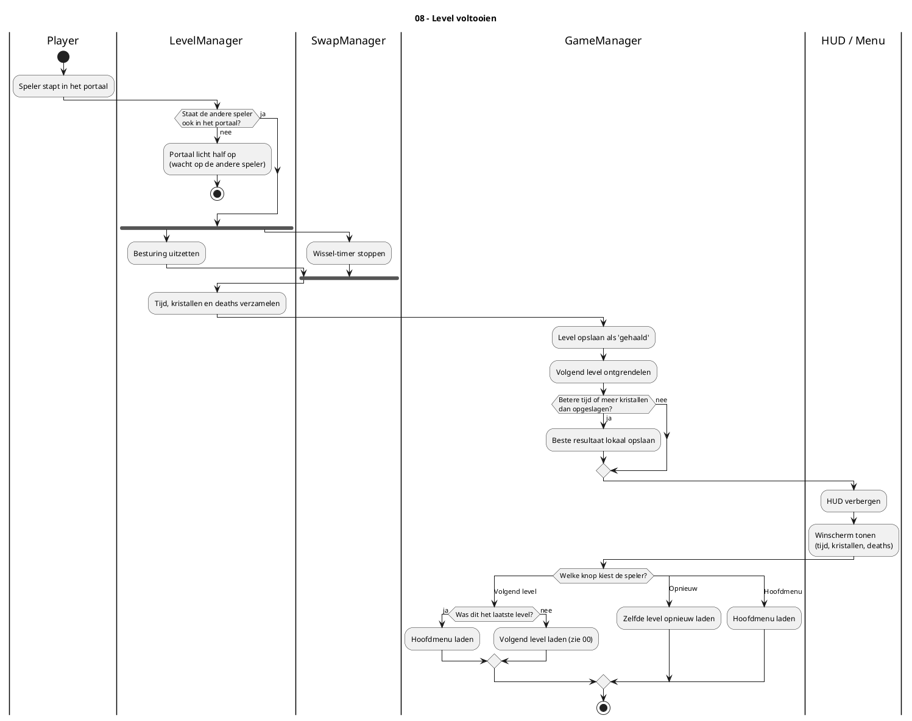

## 09 – Pauzemenu

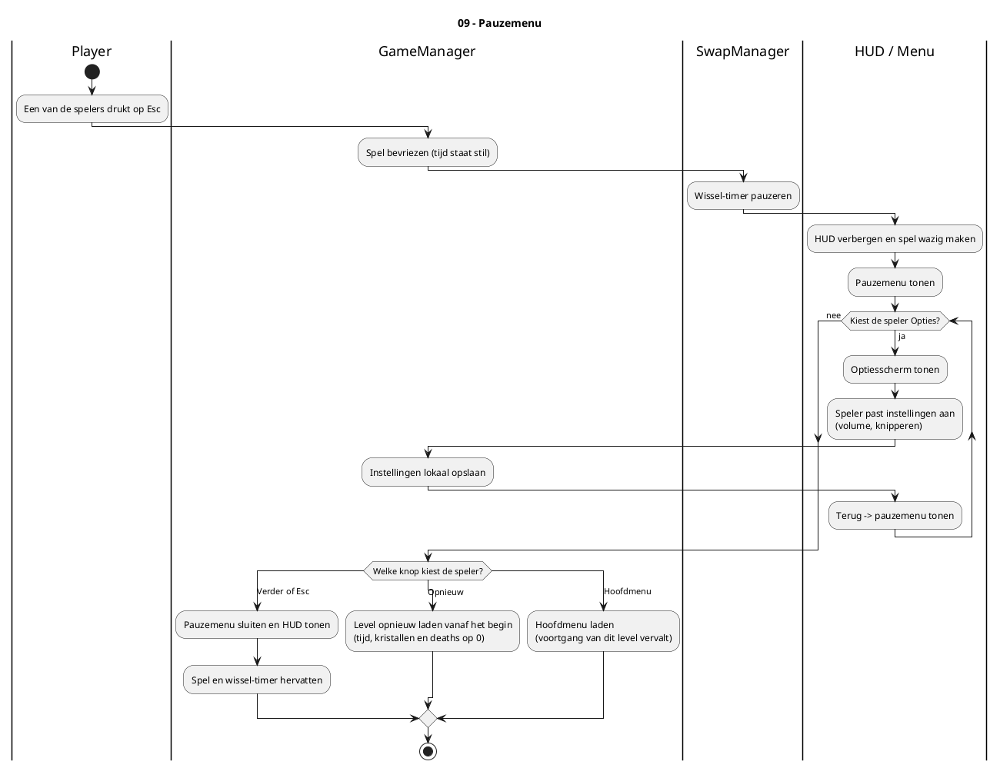
