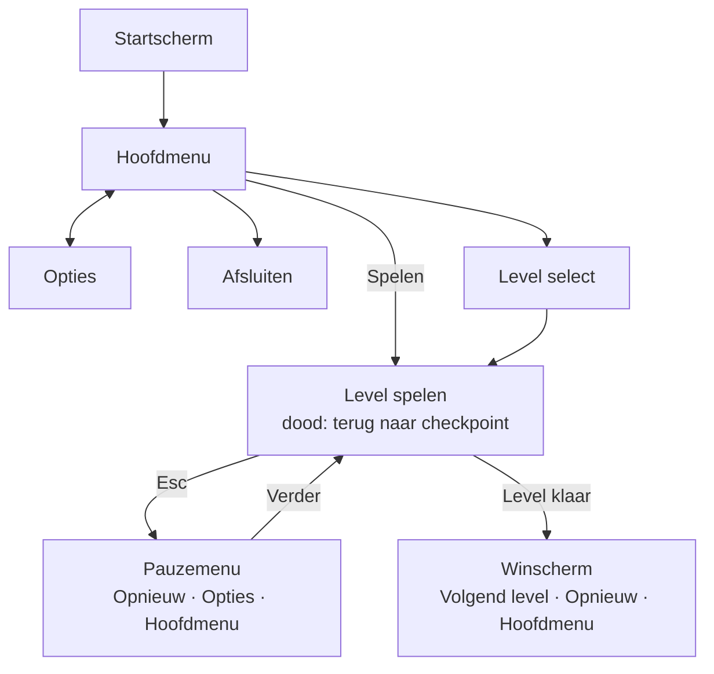

# Lumo & Nox – Ontwerp

13 oktober 2026

## Pitch

Lumo & Nox is een 2D co-op puzzel-platformer voor twee spelers op één toetsenbord. Lumo is een lichtwezentje en Nox is een schaduwwezen. Ze moeten samen door een donker bos en een vuurtoren komen.

De twist: om de zoveel seconden wisselen ze van vorm. Lumo wordt schaduw en Nox wordt licht. Een plek die net veilig was, is na de wissel ineens gevaarlijk. Je moet dus samen plannen waar je staat als de wissel komt.

Jam-thema: **Unwanted powers**.

## Thema en twist

We kiezen Unwanted powers omdat de spelers hun vorm niet zelf kiezen. De wissel overkomt ze, en dat is vaak precies wat ze niet willen.

Zo werkt de wissel:

- Elke 20 seconden wisselen Lumo en Nox van vorm (licht wordt schaduw, schaduw wordt licht).
- 3 seconden voor de wissel knippert het scherm en hoor je een piep. Zo kun je nog op tijd een veilige plek zoeken.
- Na de wissel horen ook de krachten bij de nieuwe vorm.
- In level 1 duurt een ronde 30 seconden, in level 2 20 seconden. Zo wordt het langzaam moeilijker.
- De timer loopt altijd door, ook als een speler stilstaat.

## Personages

De speler houdt zijn figuur, maar de vorm (licht of schaduw) wisselt. De kracht en de zwakte horen bij de vorm, niet bij de figuur.

|  | Lumo | Nox |
| --- | --- | --- |
| Wie | Klein lichtbolletje met oogjes | Klein schaduwfiguurtje met gloeiende ogen |
| Start-vorm | Licht | Schaduw |
| Kracht in licht-vorm | Gloed: maakt verborgen lichtplatforms zichtbaar en betreedbaar | Zelfde kracht |
| Kracht in schaduw-vorm | Schaduwstap: loopt door schaduwmuren heen | Zelfde kracht |
| Zwakte licht-vorm | Gaat dood in donkere poelen | Zelfde zwakte |
| Zwakte schaduw-vorm | Gaat dood in lichtstralen | Zelfde zwakte |

Open vraag: willen we dat elke figuur ook iets eigens heeft? Bijvoorbeeld Lumo springt hoger en Nox kan kisten duwen.

## Besturing

Twee spelers op één toetsenbord.

| Actie | Speler 1 (Lumo) | Speler 2 (Nox) |
| --- | --- | --- |
| Lopen | A / D | Pijltje links / rechts |
| Springen | W | Pijltje omhoog |
| Kracht gebruiken | S | Pijltje omlaag |
| Hendel / knop gebruiken | E | Rechter Shift |
| Pauze | Esc | Esc |

In de menu's gebruik je de muis of de pijltjes met Enter.

## Doel van een level

Een level is klaar als beide spelers tegelijk in het uitgangsportaal staan.

- Elk level past op één scherm, dus we hebben geen bewegende camera nodig.
- In elk level liggen 3 kristallen. Die zijn optioneel en tellen mee voor je score.
- Op het winscherm zie je je tijd, het aantal kristallen en hoe vaak je dood ging.

## Gevaren en puzzel-onderdelen

De puzzels draaien om licht en schaduw slim aan en uit zetten, op het goede moment voor de wissel.

| Onderdeel | Wat het doet | Gevaarlijk voor |
| --- | --- | --- |
| Lichtstraal (lamp) | Fel licht in een vaste baan | Schaduw-vorm |
| Donkere poel | Pikzwart gebied op de grond | Licht-vorm |
| Stekels / afgrond | Gewoon gevaar | Allebei |
| Hendel | Zet een lamp aan of uit | – |
| Drukknop | Opent een deur zolang iemand erop staat | – |
| Deur | Gaat open door een hendel of knop | – |
| Lichtplatform | Alleen zichtbaar met Gloed | – |
| Schaduwmuur | Alleen door te lopen met Schaduwstap | – |
| Bewegend platform | Gaat heen en weer of op en neer | – |
| Kist | Te duwen, blokkeert een lichtstraal en maakt zo schaduw | – |

## Failstate en checkpoints

Als één speler doodgaat, beginnen jullie allebei opnieuw bij het laatste checkpoint. Je doet het samen, dus je faalt ook samen.

- Er zijn geen levens. Je kunt oneindig opnieuw proberen.
- Elk level heeft 1 of 2 checkpoints (een lantaarn die gaat branden als jullie er allebei langs lopen).
- Bij een checkpoint begint de wissel-timer opnieuw.
- De dood wordt geteld en staat op het winscherm.

## HUD

De HUD is klein, want het hele level moet op één scherm zichtbaar blijven.

- **Boven in het midden:** de wissel-timer als balk die leegloopt, met de seconden erbij. De laatste 3 seconden wordt de balk rood en knippert hij.
- **Linksboven:** icoon van Lumo met zijn huidige vorm (zon = licht, maan = schaduw).
- **Rechtsboven:** hetzelfde voor Nox.
- **Rechtsonder:** aantal kristallen (bijvoorbeeld 1/3).
- In het pauzemenu verdwijnt de HUD en wordt het spel wazig, net als in het Billy Sneak-voorbeeld.

## Menu's en navigatie

Het hoofdmenu is het centrum: van daaruit ga je naar spelen, level select, opties of afsluiten.

Met Esc open je tijdens het spelen het pauzemenu. Opties is ook vanuit het pauzemenu te openen en gaat dan terug naar het pauzemenu.

## Levels

We maken 2 levels. Elk level wordt door één persoon gebouwd.

**Level 1 – Het Nachtbos (tutorial)**

- Wissel elke 30 seconden.
- Leert de basis via het level zelf: eerst lopen en springen, dan een lichtstraal, dan een donkere poel.
- De eerste wissel gebeurt op een veilige plek, zodat de spelers rustig zien wat er gebeurt.
- Korte tekstbordjes in het level leggen de knoppen uit.

**Level 2 – De Vuurtoren**

- Wissel elke 20 seconden.
- Draaiende of bewegende lampen, kisten om schaduw te maken, en deuren die alleen open gaan als de ene speler op een knop blijft staan.
- Je moet hier echt samenwerken: de één houdt de deur open terwijl de ander erdoor gaat, voordat de wissel komt.

## Techniek, assets en klassen

Voorstel: **Godot 4** met GDScript. Het is gratis, goed voor 2D en makkelijk te leren. Open vraag: kennen we Unity al beter? Dan kiezen we dat.

- **Assets:** Kenney.nl (Pixel Platformer en geluiden), aangepast naar donkere kleuren.
- **Versiebeheer:** GitHub, met een main-branch en per taak een eigen branch. Mergen via een pull request die de ander bekijkt.

Belangrijkste klassen (basis voor het klassendiagram):

| Klasse | Taak |
| --- | --- |
| Player | Lopen, springen, vorm, kracht gebruiken, doodgaan |
| SwapManager | Timer, waarschuwing, vorm van beide spelers wisselen |
| LightZone / DarkZone | Checken of een speler in de verkeerde vorm erin staat |
| Lamp | Lichtstraal aan/uit, eventueel bewegen |
| Lever / PressButton | Iets aan- of uitzetten als er iemand gebruik van maakt |
| Door | Open/dicht door een Lever of PressButton |
| MovingPlatform | Heen en weer bewegen |
| PushBox | Te duwen, blokkeert licht |
| Checkpoint | Laatste veilige plek opslaan |
| Crystal | Op te pakken, telt mee voor de score |
| LevelManager | Respawn, deaths, tijd, level klaar |
| GameManager | Scenes laden, voortgang opslaan |
| HUD / Menu | Schermen tonen |

## Taakverdeling en planning

We werken met 3 sprints van 1 week, met aan het eind van elke week een korte review en retrospective.

| Wie | Code | Level |
| --- | --- | --- |
| Osama | Player, SwapManager, HUD | Level 2 |
| Broer | Puzzel-onderdelen, menu's, LevelManager | Level 1 |

| Week | Wat |
| --- | --- |
| 1 – Ontwerpen | Dit document, klassendiagram, wireframes, menu-flowchart, Git-repo, akkoord docent |
| 2 – Bouwen | Spelers en wissel werkend, puzzel-onderdelen, level 1 en 2 bouwen, menu's |
| 3 – Testen en presenteren | Laten testen, bugs fixen, documentatie, filmpje opnemen |

## Privacy, ethiek en veiligheid

Het spel verzamelt geen persoonlijke gegevens en werkt helemaal offline.

- Alleen de voortgang (welk level gehaald is) wordt lokaal op de computer opgeslagen.
- Geen geweld of bloed: als je doodgaat, valt je figuur uit elkaar in vonkjes of rook. Geschikt voor alle leeftijden.
- De wissel-waarschuwing is zowel te zien (knipperen) als te horen (piep), zodat je hem niet mist. We houden het knipperen rustig, zodat het niet vervelend is voor mensen die gevoelig zijn voor flitsend licht.
- Alle assets komen van Kenney.nl en mogen vrij gebruikt worden.
