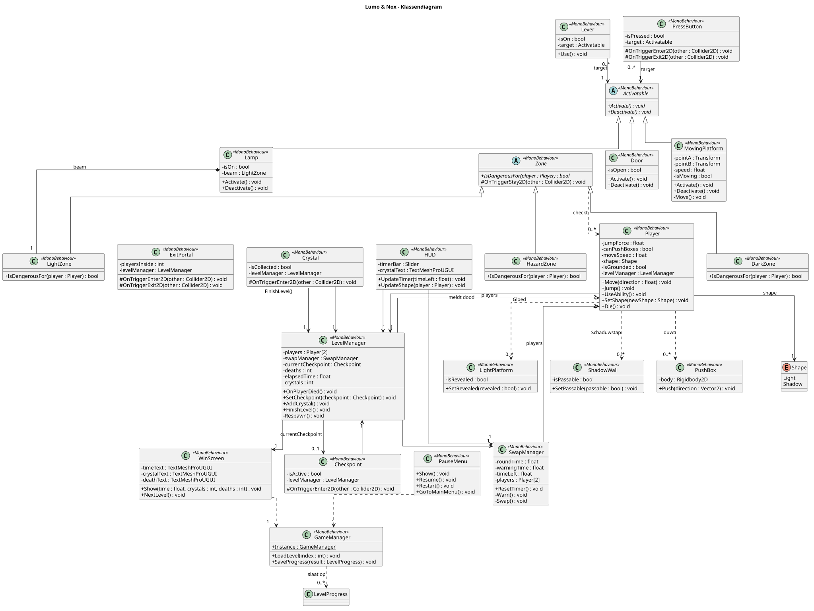
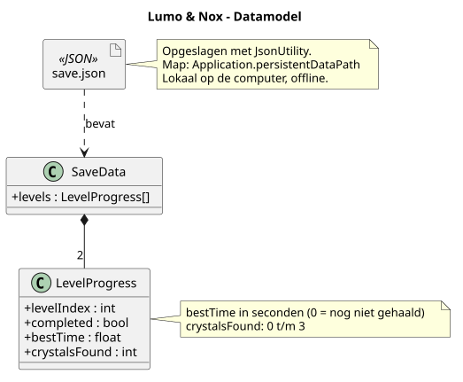

# Klassendiagram en datamodel

## Klassendiagram

We maken één klasse `Player`. Lumo en Nox zijn twee spelers met andere instellingen: Lumo heeft een hogere `jumpForce` en Nox heeft `canPushBoxes` aan. Zo hoeven we niets dubbel te schrijven.

Alles wat je aan en uit kunt zetten erft van `Activatable`: `Door`, `Lamp` en `MovingPlatform`. Een `Lever` of `PressButton` kent alleen een `target`. Zo kan één knop later ook iets anders aansturen, zonder dat we de knop aanpassen.

`LightZone`, `DarkZone` en `HazardZone` erven van `Zone`. Ze checken allemaal of een speler in gevaar is, alleen met een andere regel. `HazardZone` is gevaarlijk voor beide vormen (stekels en afgrond).

De `LevelManager` is het centrum van een level. `Player`, `Checkpoint`, `Crystal` en `ExitPortal` roepen hem aan als er iets gebeurt. Hij onthoudt het `currentCheckpoint`, telt doden en kristallen en toont het `WinScreen`. De `SwapManager` kent beide spelers en wisselt hun vorm.

`LightPlatform` en `ShadowWall` zijn de puzzel-onderdelen die reageren op de krachten Gloed en Schaduwstap. `HUD`, `PauseMenu` en `WinScreen` zijn de schermen. We houden het klein, want het is een MVP van 3 weken.

## Datamodel

We slaan alleen de voortgang op: per level of het gehaald is, de beste tijd en het aantal kristallen. Dat doen we in één JSON-bestand (`save.json`) op de eigen computer. JSON is simpel en met `JsonUtility` van Unity zit het er snel in. We bewaren geen persoonlijke gegevens, dus het spel blijft offline.
